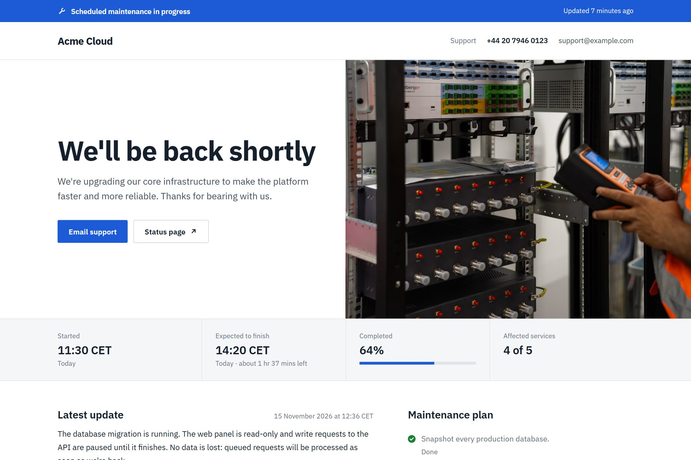
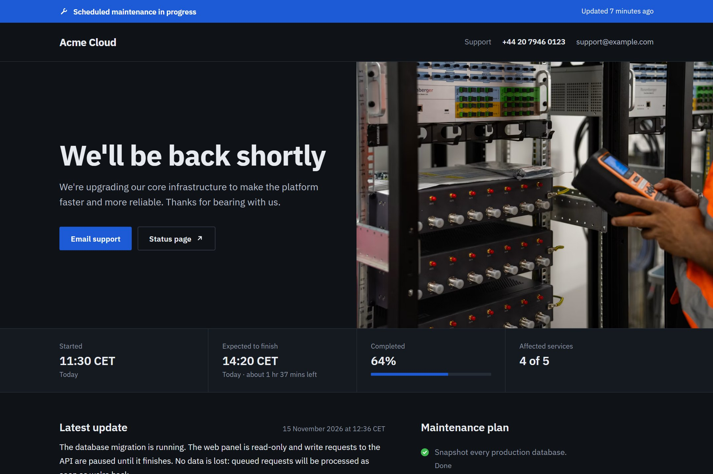
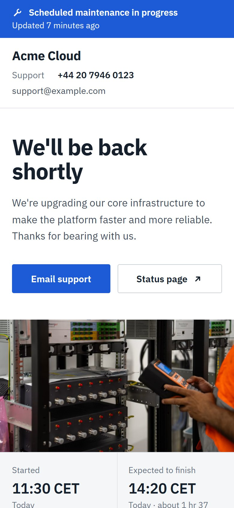

<div align="center">

[](README.md) [](README.en.md)

</div>

<div align="center">

# 🚧 Maintenance Website

**A maintenance and outage page that looks like a real company's website. Driven by a single JSON file, runs on PHP and on static hosting.**


**[See the live demo →](https://apoliak7777.github.io/maintenance-website/?demo)**



&nbsp;&nbsp;

</div>

---

## 📑 Contents

- [🔍 Overview](#-overview)
- [✨ Features](#-features)
- [🚀 Quick start](#-quick-start)
- [📂 Project structure](#-project-structure)
- [⚙️ Configuration](#️-configuration)
- [🌐 HTTP headers](#-http-headers)
- [🎨 Design and technology](#-design-and-technology)
- [⚠️ Known limitations](#️-known-limitations)
- [📄 License](#-license)

---

## 🔍 Overview

Maintenance Website is a single page for scheduled maintenance or an outage. Visitors don't get an error message but your company's page: a status bar on top, a header with phone and email, the headline next to a photo, a band with the key facts (started, expected end, completed, affected services), the latest update, service status, the maintenance plan, support contacts and a dark footer. The page refreshes itself, so once the site is up again, visitors are back without clicking anything.

The page itself is `index.html`, the look lives in `styles.css` and the logic in `app.js`. There are two ways to run it:

| Entry point  | Hosting                                       | What it does                                                                                    |
| ------------ | --------------------------------------------- | ----------------------------------------------------------------------------------------------- |
| `index.php`  | PHP (Apache, nginx + PHP-FPM, shared hosting) | answers `503 Service Unavailable` with `Retry-After` and inlines the config, CSS, JS and icon   |
| `index.html` | static (GitHub Pages, Netlify, S3)            | loads `services.json` in the browser; cannot send a 503 status                                  |

Both look identical, because the PHP version serves the very same `index.html`. Content only ever changes in `services.json` - no framework, database, build step or admin panel.

---

## ✨ Features

- 🛑 **A real 503** - `index.php` sends `503`, `Retry-After` (until the expected end, otherwise 3600 s), `Cache-Control: no-store` and `X-Robots-Tag: noindex`, so search engines and monitoring know the outage is temporary.
- 🟦 **Status bar** - a coloured bar across the top with the status text and the time of the last update ("Updated 5 minutes ago").
- 🏢 **Company header** - a name or a logo (`logo_url`) with the support phone and email on the right.
- 🖼️ **Headline with a photo** - on desktop the text sits on the left and the photo runs to the right edge of the screen; on mobile the photo goes under the text. Without a photo the intro uses the full width.
- 📊 **Facts band** - start, expected end with a countdown ("Today · about 1 hr 32 min left"), percentage done with a bar and the number of affected services. Only what is filled in is shown. If the expected end passes during a visit, the page reloads once; if it was already over on arrival, it says "any minute now" instead of reloading forever.
- 🚦 **Service status** - one row per service with its name, description and state. Five states, each with an icon, a colour and a label, so it reads fine without telling colours apart.
- 🗺️ **Maintenance plan** - steps marked done / in progress / up next, each with an ETA.
- 📰 **Latest update** - your own message with the exact date and time.
- ☎️ **Support contacts** - a large phone number, email and a status page link; plus "Email support" and "Status page" buttons up top.
- 🧾 **Dark footer** - the company name and a line of your own (`footer_text`), e.g. legal name, address or company number.
- 🌗 **Light and dark mode** - light by default; `theme` switches to dark or follows the system.
- 🌍 **English and Slovak** - `lang` switches all labels and date formats. Another language is one more block in `app.js`.
- 🔄 **Considerate auto-refresh** - the footer shows the time to the next check. Up to 10 % random jitter spreads visitors out, and background tabs wait until someone looks at them. `0` or `false` turns it off.
- 🧱 **Works without JavaScript** - the PHP version renders the brand, status, headline, tagline, photo, message and footer on the server and adds a `<meta refresh>`.
- ♿ **Accessible** - `role="progressbar"`, every state also as text, readable contrast in both modes and no animation apart from the progress fill, which is switched off with `prefers-reduced-motion`.
- 🛡️ **Safe output** - PHP escapes every string and inlines the JSON with `JSON_HEX_TAG`. `app.js` only ever uses `textContent` and allows links with the `http`, `https`, `mailto` and `tel` schemes only.

---

## 🚀 Quick start

No dependencies, no build step.

### Local preview

The static version, exactly as it runs on GitHub Pages:

```bash
python -m http.server 8000
```

The PHP version with a real 503 status (the built-in server prefers `index.php` for `/`):

```bash
php -S 127.0.0.1:8000
```

Open `http://127.0.0.1:8000/`. Check the headers:

```bash
curl -i http://127.0.0.1:8000/
```

> [!NOTE]
> Browsers render the page normally despite the `503` status. That is intended.

> [!TIP]
> Adding `?demo` to the address (e.g. `http://127.0.0.1:8000/?demo`) turns on demo mode: the start, the expected end and the update time move along with the current time, so a preview never looks stale. Don't use `?demo` on a real page.

### Deploying on PHP hosting

1. Upload `index.php`, `index.html`, `app.js`, `styles.css`, `favicon.svg` and `services.json` to a folder such as `/maintenance/`.
2. During the maintenance window, send every request to `/maintenance/index.php`. An example `.htaccess` in the web root for Apache:

   ```apache
   RewriteEngine On
   # Your own IP address still sees the live site (optional)
   RewriteCond %{REMOTE_ADDR} !=203.0.113.10
   RewriteCond %{REQUEST_URI} !^/maintenance/index\.php$
   RewriteRule ^ /maintenance/index.php [L]
   ```

3. Edit `services.json`. Changes show up on the next load - no restart, no cache to clear.

> [!IMPORTANT]
> `index.php` has to answer, not `index.html`, otherwise visitors get a 200 without `Retry-After`. If the server picks the file with `DirectoryIndex`, put `index.php` first.

> [!TIP]
> The PHP version inlines the styles, script, icon and config into the page. That is why it works on any URL the rewrite sends to it (`/shop/cart`, `/blog/post`), and why it causes no further requests to an already struggling server. The photo is the exception - put it on a CDN or use a full `https://` address.

### Static hosting

Upload the same files (`index.php` is simply ignored). On GitHub Pages, enable Pages for the repository root - that is how the [demo](https://apoliak7777.github.io/maintenance-website/?demo) runs.

---

## 📂 Project structure

```text
maintenance-website/
├── index.html      # the page: template with default texts
├── styles.css      # the look: colours, light and dark mode, layout
├── app.js          # renders the config, facts and countdown, auto-refresh, EN/SK strings
├── index.php       # PHP entry point: 503 headers, inlined config and assets, server-side texts
├── services.json   # the only configuration, read by both versions
├── favicon.svg     # icon
├── docs/           # README screenshots
├── LICENSE         # GNU GPL-3.0
├── README.md       # Slovak version
└── README.en.md    # this file
```

---

## ⚙️ Configuration

Everything is set in `services.json`. Every key is optional and older configs keep working.

| Key                    | Type                              | Default                             | Effect                                                                                           |
| ---------------------- | --------------------------------- | ----------------------------------- | ------------------------------------------------------------------------------------------------ |
| `lang`                 | `"en"` \| `"sk"`                  | `"en"`                              | Language of the labels and date formats                                                          |
| `theme`                | `"light"` \| `"dark"` \| `"auto"` | `"light"`                           | Light, dark or following the visitor's system setting                                            |
| `brand_name`           | string                            | the site's domain                   | Name in the header, the footer and the page title                                                |
| `logo_url`             | URL                               | -                                   | Logo in the header instead of the name (`https://…` or a path next to the page)                  |
| `accent_color`         | `#rgb` \| `#rrggbb`               | `#1d5bd6`                           | Colour of the status bar, buttons, progress bar, links and the "Under maintenance" state         |
| `image_url`            | URL                               | -                                   | Photo next to the headline (`https://…` or a path next to the page); without it the intro is full width |
| `image_alt`            | string                            | -                                   | Description of the photo for screen readers                                                      |
| `headline`             | string                            | "We'll be back shortly"             | `<h1>`, `<title>` and `og:title`                                                                 |
| `tagline`              | string                            | per-language text                   | Subtitle, `meta description` and `og:description`                                                |
| `status_label`         | string                            | "Scheduled maintenance in progress" | Text in the status bar                                                                           |
| `message`              | string                            | an apology                          | Text under "Latest update"                                                                       |
| `started_at`           | ISO 8601 date                     | -                                   | Start of the maintenance in the facts band                                                       |
| `countdown_target`     | ISO 8601 date                     | -                                   | Expected end, e.g. `2026-11-20T18:00:00Z`; in the facts band with the time left                  |
| `progress_percent`     | number 0-100                      | `0`                                 | Percentage done with a bar; `0` hides it                                                         |
| `auto_refresh_seconds` | number                            | `300`                               | Refresh interval, at least 60; `0` or `false` turns it off                                       |
| `timezone`             | IANA zone                         | the visitor's zone                  | Zone for every time shown, e.g. `Europe/London`                                                  |
| `contact_phone`        | string                            | -                                   | Phone in the header and, large, under "Need help?" (`tel:`)                                      |
| `contact_email`        | string                            | -                                   | Email in the header, the "Email support" button and the contact links                            |
| `contact_url`          | URL                               | -                                   | "Status page" button and link; only `http` and `https` are allowed                               |
| `footer_text`          | string                            | -                                   | Line under the company name in the footer, e.g. legal name, address, company number             |
| `updated_at`           | ISO 8601 date                     | file change time                    | Time of the last update. Without it PHP uses `filemtime`, static hosting the `Last-Modified` header |
| `services[]`           | array                             | -                                   | Objects `{ name, description, status }`                                                          |
| `next_steps[]`         | array                             | -                                   | Objects `{ action, eta, state }`                                                                 |

For `tagline` and `message`, an empty string `""` hides the element, while a missing key falls back to the default text in the chosen language. An empty `status_label` keeps the default text in the status bar. Parts without data (facts band, services, plan, contacts) are left out entirely.

### Service states

| `status`      | Label (EN / SK)                             | Colour       | Icon  |
| ------------- | ------------------------------------------- | ------------ | ----- |
| `outage`      | Outage / Výpadok                            | red          | ✕     |
| `degraded`    | Degraded performance / Obmedzená prevádzka  | amber        | !     |
| `maintenance` | Under maintenance / Údržba                  | brand colour | clock |
| `operational` | Operational / V prevádzke                   | green        | ✓     |
| anything else | the original text (`planned` → Planned)     | grey         | ?     |

Case does not matter. A missing `name` shows as "Unnamed service", a missing `description` is left out.

### Steps

| `state`   | Display                                          |
| --------- | ------------------------------------------------ |
| `done`    | green tick, step text in grey, "Done"            |
| `active`  | filled circle in the brand colour, "In progress" |
| `pending` | empty circle, "Up next"                          |

If no step has a `state`, the first one is `active` and the rest are `pending`, so older configs work unchanged. `eta` is added after the state ("In progress · ~40 min"); without it, only the state shows.

### Example `services.json`

```json
{
  "lang": "en",
  "brand_name": "My Company",
  "image_url": "server-room.jpg",
  "headline": "We'll be back shortly",
  "status_label": "Scheduled maintenance in progress",
  "started_at": "2026-11-20T16:00:00Z",
  "countdown_target": "2026-11-20T18:00:00Z",
  "progress_percent": 45,
  "contact_phone": "+44 20 7946 0000",
  "contact_email": "support@example.com",
  "footer_text": "My Company Ltd. · Example Street 1, London",
  "services": [
    { "name": "Shop", "description": "Orders are queued.", "status": "outage" },
    { "name": "Database", "description": "Moving to a new server.", "status": "maintenance" }
  ],
  "next_steps": [
    { "action": "Back up the database.", "state": "done" },
    { "action": "Migrate the data.", "eta": "~30 min", "state": "active" },
    { "action": "Verify and go live.", "eta": "~15 min" }
  ]
}
```

An example with every key is in [`services.json`](services.json) itself.

### What JSON cannot change

| Thing                                            | Where to change it                          |
| ------------------------------------------------ | ------------------------------------------- |
| `Retry-After` without an expected end (3600 s)   | `$retryAfter` in `index.php`                |
| Interface labels and more languages              | the `STRINGS` object in `app.js`            |
| Font, colours other than the brand, layout       | `styles.css` (colours at the top)           |

---

## 🌐 HTTP headers

| Header          | Value                                                     | Why                                                                  |
| --------------- | --------------------------------------------------------- | -------------------------------------------------------------------- |
| Status          | `503 Service Unavailable`                                 | Search engines and monitoring don't treat the page as real content   |
| `Retry-After`   | seconds until `countdown_target` (min. 60), else `3600`   | When the client should try again                                     |
| `Cache-Control` | `no-cache, no-store, must-revalidate`                     | The maintenance page doesn't linger in caches after you are back     |
| `X-Robots-Tag`  | `noindex, nofollow`                                       | No indexing, even by crawlers that don't read the HTML               |
| `<meta robots>` | `noindex, nofollow`                                       | The same in the HTML, so it applies to the static version too        |

---

## 🎨 Design and technology

| Layer      | Choice                                                                                                                       |
| ---------- | ---------------------------------------------------------------------------------------------------------------------------- |
| Look       | a company page: status bar, header with contacts, photo next to the headline, facts band, content separated by thin lines, dark footer; one brand colour, square buttons, no cards or effects |
| Font       | IBM Plex Sans from Google Fonts; the system font offline                                                                      |
| Styles     | plain CSS: custom properties, `color-mix()`, CSS Grid, light and dark mode                                                   |
| Script     | `app.js`, vanilla JavaScript, no libraries, no build step                                                                    |
| Backend    | `index.php`, PHP 7.2+, no framework, no extensions                                                                           |
| Icons      | hand-made inline SVG                                                                                                         |
| Data       | `services.json`, no database                                                                                                 |
| Demo photo | Valentin Lacoste on [Unsplash](https://unsplash.com/photos/technician-inspecting-server-racks-with-a-handheld-diagnostic-tool-A-b2nPSSK6E) (Unsplash License) |

---

## ⚠️ Known limitations

> [!WARNING]
> **`services.json` is publicly readable.** The static version has to download it into the browser, so never put anything in it that everyone may not see. The PHP version inlines it into the page by itself, so you can block direct access on the server, for example in Apache:
>
> ```apache
> <Files "services.json">
>     Require all denied
> </Files>
> ```

- 🔀 **Routing is up to you** - the repository only has the Apache example above. nginx, Caddy or a load balancer need their own rule.
- 📄 **The static version cannot send a 503** - GitHub Pages and similar hosts answer with 200.
- 🖼️ **The photo is not inlined** - the browser fetches it separately. The demo photo comes from Unsplash; use your own on a real page.
- 🕐 **The update time** comes from the file change time unless you set `updated_at`, so a deploy that merely rewrites the file moves it too.
- 📈 **Auto-refresh still puts load on the server** - the floor is 60 seconds. Jitter and waiting background tabs spread the load but don't remove it.
- 🔤 **The font comes from Google Fonts** - which passes the visitor's IP address to Google. If that is a GDPR concern for you, self-host the font and change the `<link>` in `index.html`.
- 🌐 **Modern browsers** - `color-mix()` is supported in browsers from 2023 on. Older ones lose some text colours; the content stays readable.
- 🧪 **No automated tests or CI.**

---

## 📄 License

The project includes a `LICENSE` file with the full text of the **GNU General Public License v3 (29 June 2007)**.

GPL-3.0 is a copyleft licence - if you distribute a modified version, you must release it under GPL-3.0 again. The licence text is an unmodified FSF template with no copyright holder and no year filled in; no source file carries a GPL header. The demo photo is not part of the repository and is covered by the Unsplash License.

---

<div align="center">

Built by **Apoliak** - [GitHub](https://github.com/Apoliak7777)

</div>
