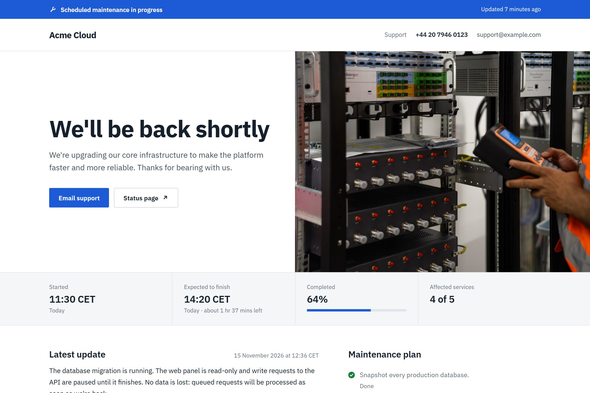
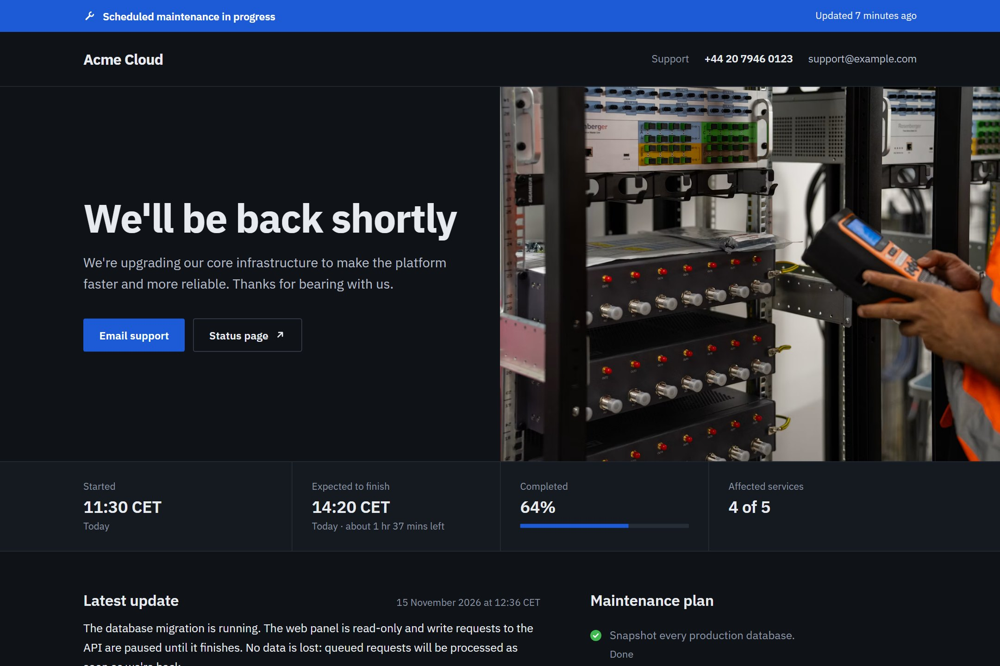
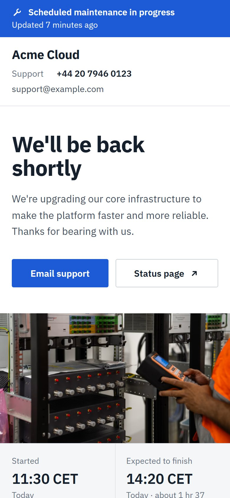

<div align="center">

[](README.md) [](README.en.md)

</div>

<div align="center">

# 🚧 Maintenance Website

**Stránka pre odstávku a výpadok, ktorá vyzerá ako web skutočnej firmy. Celá sa riadi jedným JSON súborom a beží na PHP aj na statickom hostingu.**


**[Pozrieť živé demo →](https://apoliak7777.github.io/maintenance-website/?demo)**



&nbsp;&nbsp;

</div>

---

## 📑 Obsah

- [🔍 Prehľad](#-prehľad)
- [✨ Funkcie](#-funkcie)
- [🚀 Rýchly štart](#-rýchly-štart)
- [📂 Štruktúra projektu](#-štruktúra-projektu)
- [⚙️ Konfigurácia](#️-konfigurácia)
- [🌐 HTTP hlavičky](#-http-hlavičky)
- [🎨 Dizajn a technológie](#-dizajn-a-technológie)
- [⚠️ Známe obmedzenia](#️-známe-obmedzenia)
- [📄 Licencia](#-licencia)

---

## 🔍 Prehľad

Maintenance Website je jednostránková stránka pre plánovanú odstávku alebo výpadok. Návštevník nevidí chybovú hlášku, ale stránku vašej firmy: stavový pás hore, hlavičku s telefónom a e-mailom, nadpis s fotkou, pás s najdôležitejšími údajmi (začiatok, predpokladaný koniec, hotovo, dotknuté služby), poslednú správu, stav služieb, postup prác, kontakt na podporu a tmavú pätu. Stránka sa sama obnovuje, takže keď web znova nabehne, návštevník je späť bez klikania.

Celá stránka je `index.html`, vzhľad je v `styles.css` a logika v `app.js`. Spustiť sa dá dvoma spôsobmi:

| Vstup        | Hosting                                      | Čo robí                                                                                                   |
| ------------ | -------------------------------------------- | --------------------------------------------------------------------------------------------------------- |
| `index.php`  | PHP (Apache, nginx + PHP-FPM, bežný hosting) | odpovie `503 Service Unavailable` s `Retry-After`, konfiguráciu, CSS, JS aj ikonu vloží priamo do stránky |
| `index.html` | statický (GitHub Pages, Netlify, S3)         | `services.json` načíta v prehliadači; stavový kód 503 poslať nevie                                       |

Obe verzie vyzerajú rovnako, lebo PHP verzia servíruje ten istý `index.html`. Obsah sa mení len v `services.json`, bez frameworku, databázy, build kroku aj admin rozhrania.

---

## ✨ Funkcie

- 🛑 **Skutočný 503** - `index.php` vracia `503`, `Retry-After` (do predpokladaného konca, inak 3600 s), `Cache-Control: no-store` a `X-Robots-Tag: noindex`, takže vyhľadávače aj monitoring vedia, že ide o dočasný výpadok.
- 🟦 **Stavový pás** - farebný pás nad celou stránkou s textom stavu a časom poslednej aktualizácie („Aktualizované pred 5 minútami“).
- 🏢 **Hlavička firmy** - názov alebo logo (`logo_url`) a vpravo telefón a e-mail na podporu.
- 🖼️ **Nadpis s fotkou** - na počítači text vľavo a fotka vpravo až po okraj obrazovky, na mobile fotka pod textom. Bez fotky je úvod na celú šírku.
- 📊 **Pás s faktami** - začiatok, predpokladaný koniec s odpočtom („Dnes · zostáva asi 1 h 32 min“), percento hotovej práce s pruhom a počet dotknutých služieb. Zobrazí sa len to, čo je vyplnené. Keď odhad vyprší počas návštevy, stránka sa raz obnoví; keď vypršal už pred ňou, ukáže „už každú chvíľu“ namiesto nekonečného obnovovania.
- 🚦 **Stav služieb** - riadok pre každú službu s názvom, popisom a stavom. Päť stavov, každý s ikonou, farbou aj textom, takže sa dá čítať aj bez rozlišovania farieb.
- 🗺️ **Postup prác** - kroky so stavom hotovo / prebieha / na rade a s odhadom času.
- 📰 **Posledná správa** - vlastný text s presným dátumom a časom.
- ☎️ **Kontakt na podporu** - veľký telefón, e-mail a odkaz na stavovú stránku; hore aj tlačidlá „Napísať podpore“ a „Stavová stránka“.
- 🧾 **Tmavá päta** - názov firmy a vlastný riadok (`footer_text`), napríklad obchodné meno, adresa alebo IČO.
- 🌗 **Svetlý aj tmavý režim** - predvolene svetlý, `theme` ho prepne na tmavý alebo podľa systému.
- 🌍 **Slovenčina a angličtina** - `lang` prepne popisky aj formát dátumov. Ďalší jazyk sa pridá jedným blokom v `app.js`.
- 🔄 **Šetrné obnovovanie** - päta ukazuje čas do ďalšej kontroly. Náhodný posun do 10 % rozloží návštevníkov v čase a karty na pozadí počkajú, kým sa na ne niekto pozrie. `0` alebo `false` obnovovanie vypne.
- 🧱 **Funguje aj bez JavaScriptu** - PHP verzia vykreslí značku, stav, nadpis, podnadpis, fotku, správu aj pätu na serveri a pridá `<meta refresh>`.
- ♿ **Prístupnosť** - `role="progressbar"`, stav vždy aj textom, čitateľný kontrast v oboch režimoch a žiadne animácie okrem plnenia pruhu, ktoré sa pri `prefers-reduced-motion` vypne.
- 🛡️ **Bezpečný výstup** - PHP escapuje všetky texty a JSON vkladá s `JSON_HEX_TAG`. `app.js` vkladá obsah len cez `textContent` a odkazy povolí len so schémou `http`, `https`, `mailto` a `tel`.

---

## 🚀 Rýchly štart

Projekt nemá závislosti ani build krok.

### Lokálny náhľad

Statická verzia, tak ako beží na GitHub Pages:

```bash
python -m http.server 8000
```

PHP verzia so skutočným kódom 503 (vstavaný server pri `/` uprednostní `index.php`):

```bash
php -S 127.0.0.1:8000
```

Otvorte `http://127.0.0.1:8000/`. Overenie hlavičiek:

```bash
curl -i http://127.0.0.1:8000/
```

> [!NOTE]
> Prehliadač stránku vykreslí normálne aj pri kóde `503`. To je zámer, nie chyba.

> [!TIP]
> Adresa s `?demo` (napr. `http://127.0.0.1:8000/?demo`) zapne ukážkový režim: začiatok, predpokladaný koniec aj čas aktualizácie sa posúvajú s aktuálnym časom, takže ukážka nikdy nevyzerá zastaralo. Na ostrej stránke sa `?demo` nepoužíva.

### Nasadenie na PHP hosting

1. Nahrajte `index.php`, `index.html`, `app.js`, `styles.css`, `favicon.svg` a `services.json` do priečinka, napríklad `/maintenance/`.
2. Počas odstávky presmerujte všetky požiadavky na `/maintenance/index.php`. Príklad `.htaccess` v koreni webu pre Apache:

   ```apache
   RewriteEngine On
   # Vaša IP adresa ďalej vidí ostrý web (voliteľné)
   RewriteCond %{REMOTE_ADDR} !=203.0.113.10
   RewriteCond %{REQUEST_URI} !^/maintenance/index\.php$
   RewriteRule ^ /maintenance/index.php [L]
   ```

3. Upravte `services.json`. Zmena sa prejaví pri ďalšom načítaní, bez reštartu a mazania cache.

> [!IMPORTANT]
> Odpovedať musí `index.php`, nie `index.html`, inak návštevník dostane kód 200 bez `Retry-After`. Ak server priečinok servíruje cez `DirectoryIndex`, dajte `index.php` na prvé miesto.

> [!TIP]
> PHP verzia vkladá štýly, skript, ikonu aj konfiguráciu priamo do stránky. Funguje preto na akejkoľvek adrese, kam ju presmerovanie pošle (`/eshop/kosik`, `/blog/clanok`), a preťažený server pri nej nedostane ďalšie požiadavky. Výnimkou je fotka - dajte ju na CDN alebo použite celú adresu `https://`.

### Statický hosting

Nahrajte tie isté súbory (`index.php` sa ignoruje). Na GitHub Pages stačí zapnúť Pages nad koreňom repozitára, tak beží aj [demo](https://apoliak7777.github.io/maintenance-website/?demo).

---

## 📂 Štruktúra projektu

```text
maintenance-website/
├── index.html      # celá stránka: šablóna s predvolenými textami
├── styles.css      # vzhľad: farby, svetlý a tmavý režim, rozloženie
├── app.js          # vykreslenie z konfigurácie, fakty a odpočet, obnovovanie, texty SK/EN
├── index.php       # PHP vstup: hlavičky 503, vloženie konfigurácie a súborov, texty na serveri
├── services.json   # jediná konfigurácia, číta ju PHP aj statická verzia
├── favicon.svg     # ikona
├── docs/           # snímky obrazovky do README
├── LICENSE         # GNU GPL-3.0
├── README.md       # tento súbor
└── README.en.md    # anglická verzia
```

---

## ⚙️ Konfigurácia

Všetko sa nastavuje v `services.json`. Každý kľúč je voliteľný a staré konfigurácie fungujú ďalej.

| Kľúč                   | Typ                               | Predvolené                          | Čo robí                                                                                                 |
| ---------------------- | --------------------------------- | ----------------------------------- | ------------------------------------------------------------------------------------------------------- |
| `lang`                 | `"en"` \| `"sk"`                  | `"en"`                              | Jazyk popiskov a formát dátumov                                                                         |
| `theme`                | `"light"` \| `"dark"` \| `"auto"` | `"light"`                           | Svetlý, tmavý alebo podľa nastavenia systému návštevníka                                                |
| `brand_name`           | string                            | doména stránky                      | Názov v hlavičke, v päte a v titulku stránky                                                            |
| `logo_url`             | URL                               | -                                   | Logo v hlavičke namiesto názvu (`https://…` alebo cesta vedľa stránky)                                  |
| `accent_color`         | `#rgb` \| `#rrggbb`               | `#1d5bd6`                           | Farba stavového pásu, tlačidiel, pruhu hotovej práce, odkazov a stavu „Údržba“                          |
| `image_url`            | URL                               | -                                   | Fotka vedľa nadpisu (`https://…` alebo cesta vedľa stránky); bez nej je úvod na celú šírku              |
| `image_alt`            | string                            | -                                   | Popis fotky pre čítačky obrazovky                                                                       |
| `headline`             | string                            | „We'll be back shortly“             | `<h1>`, `<title>` a `og:title`                                                                          |
| `tagline`              | string                            | text podľa jazyka                   | Podnadpis, `meta description` a `og:description`                                                        |
| `status_label`         | string                            | „Scheduled maintenance in progress“ | Text v stavovom páse                                                                                    |
| `message`              | string                            | ospravedlnenie                      | Text v časti „Posledná správa“                                                                          |
| `started_at`           | dátum ISO 8601                    | -                                   | Začiatok údržby v páse s faktami                                                                        |
| `countdown_target`     | dátum ISO 8601                    | -                                   | Predpokladaný koniec, napr. `2026-11-20T18:00:00+01:00`; v páse s faktami aj s tým, koľko zostáva      |
| `progress_percent`     | číslo 0-100                       | `0`                                 | Percento hotovej práce s pruhom; `0` ho skryje                                                          |
| `auto_refresh_seconds` | číslo                             | `300`                               | Interval obnovenia, minimálne 60; `0` alebo `false` ho vypne                                            |
| `timezone`             | pásmo IANA                        | pásmo návštevníka                   | Pásmo pre všetky časy, napr. `Europe/Bratislava`                                                        |
| `contact_phone`        | string                            | -                                   | Telefón v hlavičke a veľký v časti „Potrebujete pomoc?“ (`tel:`)                                        |
| `contact_email`        | string                            | -                                   | E-mail v hlavičke, tlačidlo „Napísať podpore“ a odkaz v kontakte                                        |
| `contact_url`          | URL                               | -                                   | Tlačidlo a odkaz „Stavová stránka“; povolené sú len `http` a `https`                                    |
| `footer_text`          | string                            | -                                   | Riadok v päte pod názvom firmy, napr. obchodné meno, adresa, IČO                                        |
| `updated_at`           | dátum ISO 8601                    | čas zmeny súboru                    | Čas poslednej aktualizácie. Bez neho PHP použije `filemtime`, statický hosting hlavičku `Last-Modified` |
| `services[]`           | pole                              | -                                   | Objekty `{ name, description, status }`                                                                 |
| `next_steps[]`         | pole                              | -                                   | Objekty `{ action, eta, state }`                                                                        |

Pri `tagline` a `message` prázdny reťazec `""` daný prvok skryje, chýbajúci kľúč použije predvolený text vo zvolenom jazyku. Prázdny `status_label` necháva v páse predvolený text. Časti bez údajov (pás s faktami, služby, postup, kontakt) sa nezobrazia vôbec.

### Stavy služieb

| `status`      | Text (EN / SK)                              | Farba         | Ikona  |
| ------------- | ------------------------------------------- | ------------- | ------ |
| `outage`      | Outage / Výpadok                            | červená       | ✕      |
| `degraded`    | Degraded performance / Obmedzená prevádzka  | jantárová     | !      |
| `maintenance` | Under maintenance / Údržba                  | farba značky  | hodiny |
| `operational` | Operational / V prevádzke                   | zelená        | ✓      |
| čokoľvek iné  | pôvodný text (`planned` → Planned)          | sivá          | ?      |

Na veľkosti písmen nezáleží. Chýbajúci `name` sa zobrazí ako „Unnamed service“ / „Služba bez názvu“, chýbajúci `description` sa vynechá.

### Kroky

| `state`   | Zobrazenie                                      |
| --------- | ----------------------------------------------- |
| `done`    | zelená fajka, text kroku sivou, „Hotovo“        |
| `active`  | plný krúžok vo farbe značky, „Prebieha“         |
| `pending` | prázdny krúžok, „Na rade“                       |

Ak žiadny krok `state` nemá, prvý je `active` a ostatné `pending`, takže staré konfigurácie fungujú bez zmeny. `eta` sa pripíše za stav („Prebieha · ~40 min“); keď chýba, zobrazí sa len stav.

### Ukážkový `services.json`

```json
{
  "lang": "sk",
  "brand_name": "Moja firma",
  "image_url": "foto-serverovna.jpg",
  "headline": "Čoskoro sme späť",
  "status_label": "Prebieha plánovaná údržba",
  "started_at": "2026-11-20T16:00:00+01:00",
  "countdown_target": "2026-11-20T18:00:00+01:00",
  "progress_percent": 45,
  "contact_phone": "+421 900 000 000",
  "contact_email": "podpora@example.com",
  "footer_text": "Moja firma s.r.o. · Hlavná 1, Bratislava",
  "services": [
    { "name": "E-shop", "description": "Objednávky čakajú vo fronte.", "status": "outage" },
    { "name": "Databáza", "description": "Presúvame dáta na nový server.", "status": "maintenance" }
  ],
  "next_steps": [
    { "action": "Záloha databázy.", "state": "done" },
    { "action": "Migrácia dát.", "eta": "~30 min", "state": "active" },
    { "action": "Kontrola a spustenie.", "eta": "~15 min" }
  ]
}
```

Príklad so všetkými kľúčmi je priamo v [`services.json`](services.json).

### Čo sa cez JSON nastaviť nedá

| Vec                                       | Kde sa mení                                  |
| ----------------------------------------- | -------------------------------------------- |
| `Retry-After` bez predpokladaného konca (3600 s) | `$retryAfter` v `index.php`           |
| Popisky rozhrania a ďalšie jazyky         | objekt `STRINGS` v `app.js`                  |
| Písmo, farby okrem značky, rozloženie     | `styles.css` (farby na začiatku súboru)      |

---

## 🌐 HTTP hlavičky

| Hlavička        | Hodnota                                               | Prečo                                                               |
| --------------- | ----------------------------------------------------- | ------------------------------------------------------------------- |
| Status          | `503 Service Unavailable`                             | Vyhľadávače ani monitoring stránku nepovažujú za platný obsah       |
| `Retry-After`   | sekundy do `countdown_target` (min. 60), inak `3600`  | Kedy to má klient skúsiť znova                                      |
| `Cache-Control` | `no-cache, no-store, must-revalidate`                 | Maintenance stránka nezostane v cache po obnove služby              |
| `X-Robots-Tag`  | `noindex, nofollow`                                   | Poistka proti indexácii aj pre crawlery, ktoré HTML nečítajú        |
| `<meta robots>` | `noindex, nofollow`                                   | To isté priamo v HTML, platí aj pre statickú verziu                 |

---

## 🎨 Dizajn a technológie

| Vrstva  | Riešenie                                                                                                                      |
| ------- | ----------------------------------------------------------------------------------------------------------------------------- |
| Vzhľad  | firemná stránka: stavový pás, hlavička s kontaktmi, fotka vedľa nadpisu, pás s faktami, obsah oddelený čiarami, tmavá päta; jedna farba značky, hranaté tlačidlá, bez kariet a efektov |
| Písmo   | IBM Plex Sans z Google Fonts; bez internetu systémové písmo                                                                    |
| Štýly   | čisté CSS: custom properties, `color-mix()`, CSS Grid, svetlý a tmavý režim                                                   |
| Skript  | `app.js`, čistý JavaScript bez knižníc a bez build kroku                                                                      |
| Backend | `index.php`, PHP 7.2+ bez frameworku a bez rozšírení                                                                          |
| Ikony   | vlastné inline SVG                                                                                                            |
| Dáta    | `services.json`, žiadna databáza                                                                                              |
| Fotka v ukážke | Valentin Lacoste, [Unsplash](https://unsplash.com/photos/technician-inspecting-server-racks-with-a-handheld-diagnostic-tool-A-b2nPSSK6E) (licencia Unsplash) |

---

## ⚠️ Známe obmedzenia

> [!WARNING]
> **`services.json` je verejne čitateľný.** Statická verzia ho musí stiahnuť do prehliadača, takže doň nedávajte nič, čo nemá vidieť každý. PHP verzia ho vkladá do stránky sama, takže priamy prístup k nemu môžete na serveri zakázať, napríklad v Apache:
>
> ```apache
> <Files "services.json">
>     Require all denied
> </Files>
> ```

- 🔀 **Presmerovanie je na vás** - repozitár obsahuje len príklad pravidla pre Apache vyššie. Nginx, Caddy alebo load balancer treba nastaviť podľa vlastného servera.
- 📄 **Statická verzia nevie poslať 503** - na GitHub Pages a podobných hostingoch odpovedá kódom 200.
- 🖼️ **Fotka sa do stránky nevkladá** - prehliadač ju sťahuje zvlášť. Fotka v ukážke ide z Unsplash; na ostrú stránku dajte vlastnú.
- 🕐 **Čas aktualizácie** sa bez `updated_at` berie z času zmeny súboru, takže ho posunie aj nasadenie, ktoré súbor len prepíše.
- 📈 **Obnovovanie stále zaťažuje server** - minimum je 60 sekúnd. Náhodný posun a čakanie kariet na pozadí záťaž rozložia, ale neodstránia.
- 🔤 **Písmo ide z Google Fonts** - IP adresa návštevníka sa pri tom dostane ku Google. Ak to kvôli GDPR nechcete, stiahnite písmo k sebe a upravte `<link>` v `index.html`.
- 🌐 **Moderné prehliadače** - `color-mix()` podporujú prehliadače od roku 2023. V starších niektoré farby textu vypadnú, obsah zostane čitateľný.
- 🧪 **Bez automatických testov a CI.**

---

## 📄 Licencia

Projekt obsahuje súbor `LICENSE` s úplným textom **GNU General Public License v3 (29. jún 2007)**.

GPL-3.0 je copyleft licencia - ak distribuujete upravenú verziu, musíte ju uvoľniť opäť pod GPL-3.0. Text licencie je nezmenená FSF šablóna a nemá vyplneného držiteľa autorských práv ani rok; žiadny zdrojový súbor nenesie GPL hlavičku. Fotka v ukážke nie je súčasťou repozitára a platí pre ňu licencia Unsplash.

---

<div align="center">

Vytvoril **Apoliak** - [GitHub](https://github.com/Apoliak7777)

</div>
